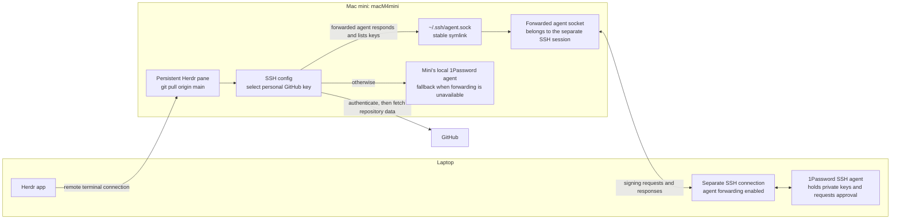

# GitHub authentication from Herdr on the Mac mini

This setup lets Git commands in persistent Herdr panes on `macM4mini` use
the laptop's 1Password SSH agent. Private keys remain on the laptop; the
Mini forwards authentication requests to that agent.

The working setup currently requires a separate SSH connection from the
laptop to remain open. Forwarding through Herdr's own connection has not
been configured or verified. This guide describes SSH authentication to
GitHub, not Git commit signing.

## How the pieces connect



The separate SSH connection supplies forwarding; Git's connection to
GitHub originates on the Mini. GitHub verifies the signature produced by
the selected agent. No private key is copied to the Mini.

## Laptop: select the correct agent

The laptop's default `SSH_AUTH_SOCK` pointed to an Apple launchd agent
that had no identities. Its working 1Password socket is:

```text
~/Library/Group Containers/2BUA8C4S2C.com.1password/t/agent.sock
```

In a local laptop terminal, set a shell variable and check the agent:

```sh
laptop_agent="$HOME/Library/Group Containers/2BUA8C4S2C.com.1password/t/agent.sock"
SSH_AUTH_SOCK="$laptop_agent" ssh-add -l
```

The output should include the personal GitHub key. This command selects
the socket only for `ssh-add`; it does not change the shell's default agent.
If the socket is missing, check that the SSH agent is enabled in the
laptop's 1Password developer settings.

Connect to the Mini using that agent:

```sh
ssh -A -o "IdentityAgent=\"$laptop_agent\"" saegey@macM4mini.local
```

`-A` enables forwarding. `IdentityAgent` selects the laptop agent to
forward. The embedded quotes are necessary because the socket path
contains spaces. Keep this SSH connection open while using Git in Herdr.

## Mini: keep a stable path for persistent panes

The Mini's machine-local `~/.ssh/rc` runs on SSH login and updates a
stable symlink to the new session's forwarded socket:

```sh
#!/bin/sh
if [ -S "$SSH_AUTH_SOCK" ] && [ "$SSH_AUTH_SOCK" != "$HOME/.ssh/agent.sock" ]; then
  ln -sf "$SSH_AUTH_SOCK" "$HOME/.ssh/agent.sock"
fi
```

Persistent Herdr panes can lack `SSH_CONNECTION` and retain an old
environment. The stable path lets those panes use a newly forwarded agent
without restarting their shells. Testing only whether `SSH_CONNECTION`
is empty cannot reliably distinguish these panes from local work.

The most recent agent-forwarded SSH login updates the shared symlink.
Closing that session can leave the link pointing to a missing socket.
Another open SSH session does not automatically repair the link.

## Mini: choose the agent and GitHub identity

The shared `~/.ssh/config` includes `~/.ssh/config.local` first. The
relevant machine-local rules are below; keep existing deployment-specific
includes before these rules, and keep these rules before wildcard agent
settings. SSH generally uses the first value obtained for each option.

```sshconfig
# Prefer a forwarded agent that responds and lists identities.
Match originalhost github.com exec "SSH_AUTH_SOCK=$HOME/.ssh/agent.sock /usr/bin/ssh-add -l >/dev/null 2>&1"
  IdentityAgent ~/.ssh/agent.sock

# Fallback when the forwarded-agent check fails.
Host github.com
  IdentityAgent ~/.1password/agent.sock

# Reset the conditional scope before other host rules.
Host *
```

The existing GitHub host block also selects the personal key:

```sshconfig
Host github.com
  User git
  IdentityFile ~/.ssh/id_rsa_personal_github.pub
  IdentitiesOnly yes
```

The `.pub` file identifies the desired key; the selected agent holds its
private counterpart. `IdentitiesOnly yes` keeps SSH from trying unrelated
agent identities. These rules apply to the original hostname `github.com`;
other GitHub aliases need their own matching configuration.

The Mini's `~/.1password/agent.sock` points to its own 1Password socket.
That path did not exist on the laptop, so it cannot be assumed to work
on both machines.

### Behavior when working locally on the Mini

If no forwarded agent responds and lists identities, GitHub uses the
Mini's local 1Password agent, with approval handled on the Mini. If a
forwarded agent is available, local Git commands also prefer it and may
request approval on the laptop. This choice depends on agent availability,
not where the terminal window is displayed.

## Verify the connection

Inside the separate SSH session, confirm forwarding:

```sh
echo "$SSH_AUTH_SOCK"
ssh-add -l
```

The socket variable should be populated and the agent should list the
laptop's keys. Then, inside the existing Herdr pane, inspect the selected
agent and retry the pull:

```sh
ssh -G git@github.com | awk '/^identityagent /'
git pull origin main
```

With forwarding active, the selected path should be
`/Users/saegey/.ssh/agent.sock`. Approve on the laptop if 1Password asks.
This workflow was verified by a successful pull from the Herdr pane.

## Troubleshooting

| Symptom | Meaning and next check |
| --- | --- |
| Laptop reports `No such file or directory` for `~/.1password/agent.sock` | Use the laptop's full 1Password socket path above. |
| Laptop's default `ssh-add -l` reports no identities | Select the 1Password socket explicitly. |
| SSH reports `keyword identityagent extra arguments at end of line` | Preserve the embedded quotes around the path containing spaces. |
| New SSH session has an empty `SSH_AUTH_SOCK` | Forwarding did not arrive; check the laptop's selected agent and client/server forwarding restrictions. A successful SSH login alone does not prove forwarding works. |
| Herdr selects the Mini's local 1Password agent | The forwarded-agent check failed. Check the open forwarding connection and the stable socket link. |
| `agent refused operation` | The selected agent refused signing. Check which agent is selected, whether it has the intended key, and its approval state. This error alone does not identify which agent was used. |
| Git stops working after the separate SSH session closes | Reconnect with forwarding to refresh the stable socket link. |

Only forward an agent to trusted machines: processes running as your user
there can request authentication while the forwarded agent is available.

## Remaining Herdr configuration

The separate connection is the verified workaround. To remove that
dependency, Herdr's own connection from the laptop to the Mini must use
the laptop's 1Password agent and enable agent forwarding. The exact Herdr
setting and whether it honors the laptop's SSH config remain unverified;
adding a `ForwardAgent` rule alone has not been established as sufficient.

The Mini's agent selection and login hook are machine-local files. This
document records them; it does not install or change them.
